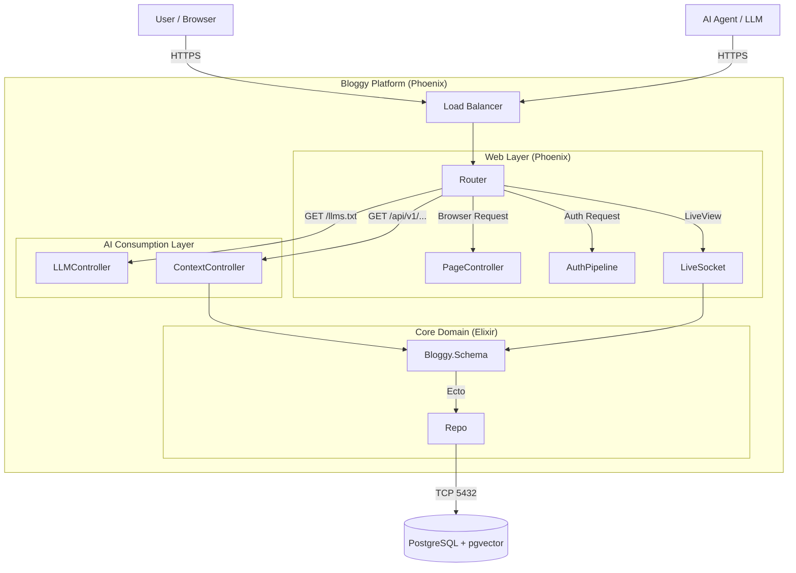
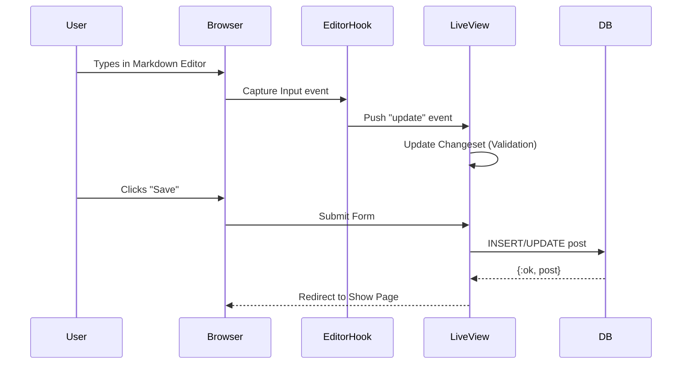

# System Architecture

## Overview

Bloggy is a Phoenix 1.7 application designed as an **AI-Native Publishing Platform**. It serves two distinct classes of users:
1.  **Humans**: Via a responsive, server-rendered HTML interface (LiveView).
2.  **Agents**: Via high-density, machine-readable endpoints (`llms.txt`, Context API).

## System Boundaries

## Core Contexts

### 1. `Bloggy.Accounts`
Handles user identity, registration, and authentication.
- **Key Schemas**: `User`, `Company`
- **Dependencies**: `Bcrypt` for password hashing.

### 2. `Bloggy.Schema`
The primary content domain.
- **Key Schemas**: `Post`
- **Responsibilities**:
    - CRUD operations for content.
    - Markdown storage (body).
    - Taxonomy and Metadata.

### 3. `BloggyWeb`
The presentation layer.
- **Controllers**: Traditional HTTP request/response.
- **LiveViews**: Stateful, real-time UI components.
- **API**: JSON endpoints for external consumption.

## AI Ingestion Pipeline

How AI Agents consume Bloggy content:

1.  **Discovery**: Agent requests `/llms.txt`.
2.  **Mapping**: Server returns a plain-text list of all available resource URLs and descriptions.
3.  **Consumption**: Agent iterates through the list, requesting specific `/api/v1/posts/:id/context` endpoints.
4.  **Ingestion**: Server returns structured JSON with raw Markdown, optimized for vector database embedding.

## Data Flow: Content Creation

