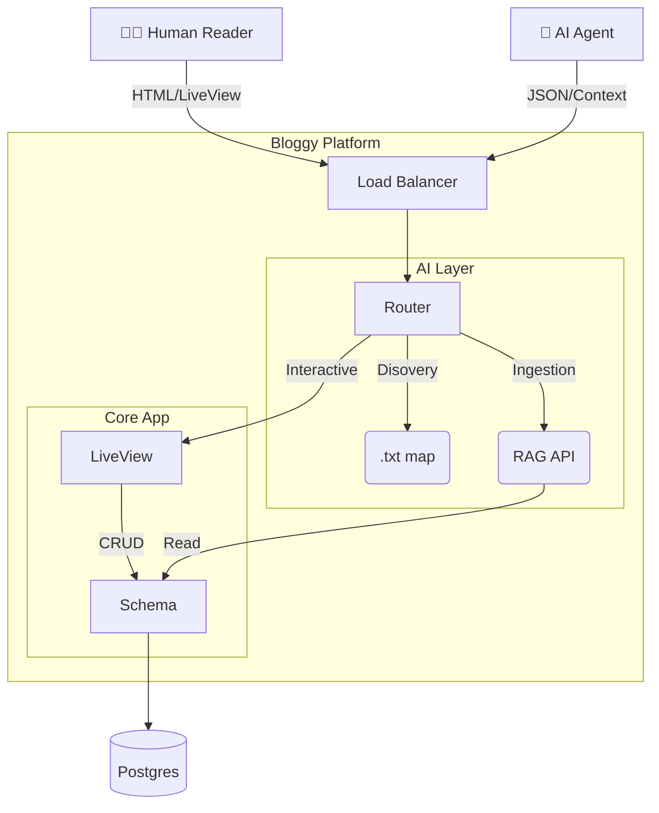

# Bloggy 🤖

> **Not just a blog. A Knowledge Graph for the Agentic Web.**  
> Built with [Phoenix 1.7](https://www.phoenixframework.org/), [LiveView](https://hexdocs.pm/phoenix_live_view/welcome.html), and [Tailwind 3](https://tailwindcss.com/).

[](https://elixir-lang.org)
[](https://www.phoenixframework.org/)
[](/llms.txt)
[](https://github.com/csa7mdm/bloggy/actions/workflows/ci.yml)


## 📖 The Story

The web is evolving. Content is no longer just for human eyes—it's efficiently consumed by AI agents, LLMs, and semantic search engines. **Bloggy** is the answer to this shift.

It is a modern publishing platform engineered from the ground up to serve two masters:
1.  **Humans:** Who demand a beautiful, fast (LiveView-powered), and responsive reading experience.
2.  **Machines:** Who require high-token-density, structured data ingestion (RAG-ready).

Stop building tailored APIs for every new AI tool. Bloggy speaks "LLM" natively.

## 📐 Architecture

Bloggy sits at the intersection of a traditional CMS and a Vector Data Source.



## 🚀 Key Features

### For the AI Age
*   **🗺 `llms.txt` Standard**: A dedicated `/llms.txt` route provides a standardized content map, allowing AI crawlers to discover your content structure in milliseconds.
*   **🧠 Context API**: The `/api/v1/posts/:id/context` endpoint delivers your content stripped of HTML noise, enriched with metadata, and optimized for Vector Database embedding costs.
*   **🔍 Semantic First**: HTML structure is rigorously semantic, ensuring even standard scrapers get high-quality signals.

### For the Production Engineer
*   **⚡️ Phoenix LiveView**: Developing rich, interactive UIs (like the admin dashboard) without writing a single line of React or client-side Javascript.
*   **🔐 Built-in Auth**: Role-based access control (RBAC) securely implemented with Guardian.
*   **🎨 Tailwind CSS**: A utility-first styling engine that scales.
*   **📝 Markdown Core**: Content is stored as pure Markdown, future-proofing your data against platform lock-in.

## 🛠 Getting Started

Get your instance running in less than 2 minutes.

### Prerequisites
*   Elixir 1.14+
*   PostgreSQL 12+
*   Node.js 18+

### Quick Start

1.  **Install Dependencies**
    ```bash
    mix deps.get
    cd assets && npm install && cd ..
    ```

2.  **Initialize Database**
    ```bash
    # Designed to be idempotent
    mix ecto.setup
    ```

3.  **Launch**
    ```bash
    mix phx.server
    ```

Visit `http://localhost:4000` to see your new platform.

## 🛤 Roadmap

We are currently in **Horizon 4 (Professionalization)**.

| Phase | Focus | Status |
|:---|:---|:---|
| **Horizon 1** | **Foundation** – Core CRUD, Database, Authentication. | ✅ Complete |
| **Horizon 2** | **Design** – Tailwind implementation, Responsive UI. | ✅ Complete |
| **Horizon 3** | **AI Integration** – `llms.txt`, Context API, RAG Hooks. | ✅ Complete |
| **Horizon 4** | **Scale & Ops** – CI/CD, Testing, Plugin Architecture. | 🔄 **In Progress** |
| **Horizon 5** | **The Future** – Vector Search, Auto-Summarization. | 🔜 Planned |

*See full details in [ROADMAP.md](ROADMAP.md).*

## 🧪 Testing & Quality

We maintain a rigorous standard of code quality to ensure reliability for both human and machine consumers.

```bash
# Run the full suite (Unit + Integration)
mix test

# Check code style
mix format --check-formatted
```

## 📚 Documentation

*   **[ARCHITECTURE.md](ARCHITECTURE.md)**: Deep dive into the system boundaries and data flow.
*   **[Context API Schema](lib/bloggy_web/controllers/api/context_controller.ex)**: Implementation details of the AI endpoints.

## License

MIT © 2026 Bloggy Team.
